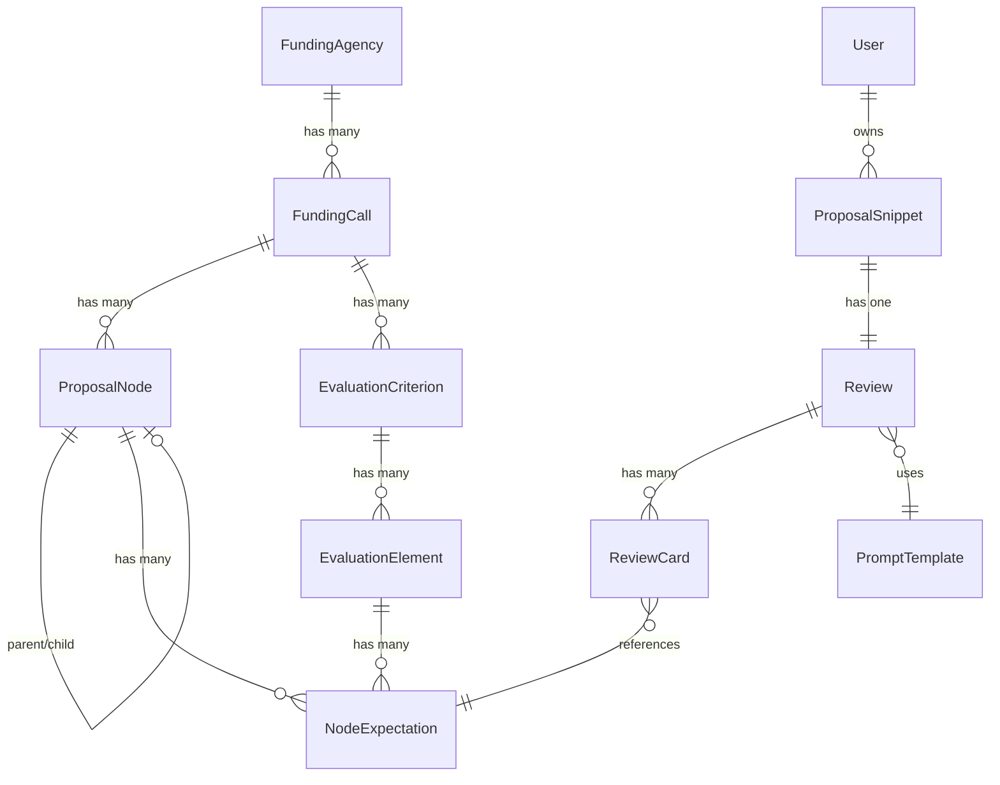

# Domain Model: Stage 1 (Finalized)

## Overview
11 tables. MVP scope. No scoring, no rewriting, no full proposals.

---

## 1. FundingAgency
| Field | Type | Notes |
|-------|------|-------|
| id | UUID (PK) | |
| name | String | e.g., "European Research Council" |
| short_name | String (Unique) | e.g., "ERC" |
| description | Text | |
| created_at | Timestamp | |
| updated_at | Timestamp | |

---

## 2. FundingCall
| Field | Type | Notes |
|-------|------|-------|
| id | UUID (PK) | |
| funding_agency_id | FK → FundingAgency | |
| name | String | e.g., "ERC Starting Grant 2024" |
| code | String | e.g., "ERC-2024-STG" |
| aim_objectives | Text | |
| scope | Text | |
| general_guidelines | Text | |
| call_year | Integer | |
| is_active | Boolean | |
| created_at | Timestamp | |
| updated_at | Timestamp | |

---

## 3. ProposalNode
Recursive hierarchy for proposal sections/subsections.
| Field | Type | Notes |
|-------|------|-------|
| id | UUID (PK) | |
| funding_call_id | FK → FundingCall | |
| parent_node_id | FK → ProposalNode (Nullable) | NULL for root sections |
| node_type | Enum: `SECTION`, `SUBSECTION` | |
| title | String | e.g., "B1. Scientific Excellence" |
| order_index | Integer | |
| guidance_text | Text | **What the applicant should write here.** |
| created_at | Timestamp | |
| updated_at | Timestamp | |

---

## 4. EvaluationCriterion
High-level criterion for a funding call.
| Field | Type | Notes |
|-------|------|-------|
| id | UUID (PK) | |
| funding_call_id | FK → FundingCall | |
| name | String | e.g., "Excellence" |
| description | Text | |
| order_index | Integer | |
| created_at | Timestamp | |
| updated_at | Timestamp | |

---

## 5. EvaluationElement
Atomic evaluable concern under a criterion.
| Field | Type | Notes |
|-------|------|-------|
| id | UUID (PK) | |
| evaluation_criterion_id | FK → EvaluationCriterion | |
| name | String | e.g., "Clarity of Objectives" |
| description | Text | |
| created_at | Timestamp | |
| updated_at | Timestamp | |

---

## 6. NodeExpectation ⭐ (Intelligence Layer)
Maps a ProposalNode to an EvaluationElement with context.
| Field | Type | Notes |
|-------|------|-------|
| id | UUID (PK) | |
| proposal_node_id | FK → ProposalNode | |
| evaluation_element_id | FK → EvaluationElement | |
| expectation_strength | Enum: `MANDATORY`, `IMPORTANT`, `OPTIONAL` | |
| evaluation_intent | Enum: `COMPLIANCE`, `QUALITY`, `RISK`, `STRATEGIC_FIT` | |
| guidance_note | Text | **What the reviewer should look for.** |
| order_index | Integer | |
| created_at | Timestamp | |
| updated_at | Timestamp | |

---

## 7. User
| Field | Type | Notes |
|-------|------|-------|
| id | UUID (PK) | |
| email | String (Nullable) | NULL for anonymous |
| is_anonymous | Boolean | TRUE for MVP |
| created_at | Timestamp | |
| updated_at | Timestamp | |

**Lifecycle (MVP)**: Created on first snippet. Cascade-deleted after TTL (24-72h).

---

## 8. ProposalSnippet
| Field | Type | Notes |
|-------|------|-------|
| id | UUID (PK) | |
| user_id | FK → User | |
| funding_call_id | FK → FundingCall | |
| proposal_node_id | FK → ProposalNode | |
| pasted_text | Text | |
| expires_at | Timestamp | Mandatory. Default: created_at + 24h. |
| created_at | Timestamp | |

---

## 9. PromptTemplate
| Field | Type | Notes |
|-------|------|-------|
| id | UUID (PK) | |
| name | String | |
| version | Integer | |
| template_text | Text | |
| is_active | Boolean | |
| created_at | Timestamp | |
| updated_at | Timestamp | |

**Immutability Rule**: New row on update. Old row set `is_active = false`.

---

## 10. Review
| Field | Type | Notes |
|-------|------|-------|
| id | UUID (PK) | |
| proposal_snippet_id | FK → ProposalSnippet | |
| prompt_template_id | FK → PromptTemplate | |
| created_at | Timestamp | |

---

## 11. ReviewCard
| Field | Type | Notes |
|-------|------|-------|
| id | UUID (PK) | |
| review_id | FK → Review | |
| node_expectation_id | FK → NodeExpectation | **Links to expectation, not element.** |
| feedback_text | Text | |
| created_at | Timestamp | |

---

## Cardinality Summary

## Data Flow
1. User selects `FundingCall` → `ProposalNode`.
2. System fetches all `NodeExpectation` records for that node.
3. System assembles prompt using `ProposalNode.guidance_text` + `NodeExpectation.guidance_note` + `PromptTemplate`.
4. AI returns feedback blocks.
5. System creates `Review` + multiple `ReviewCard` records, each linked to a `NodeExpectation`.

## Rejected Fields (MVP)
- `scores` on ReviewCard
- `User.password` / auth fields
- `ProposalNode.version_id`
- Soft-delete (`deleted_at`)
