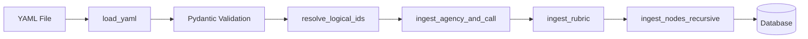

# Walkthrough: Task 5.0 - Admin Ingestion (Call Definition as Code)

**Completed**: 2026-02-07
**Task ID**: 5.0

## Summary

Implemented a complete YAML ingestion pipeline for defining funding call structures as code. This enables technical admins to define a complete Funding Call (metadata, rubric, proposal hierarchy, and evaluation logic) in a single version-controlled YAML file.

## What Was Built

### 1. YAML Schemas (`backend/app/schemas/call_definitions.py`)

Created 7 Pydantic models with 1:1 mapping to database models:

| Schema | Purpose |
|--------|---------|
| `FundingAgencyDefinition` | Agency metadata (name, short_name) |
| `FundingCallDefinition` | Call metadata (name, code, year, objectives) |
| `EvaluationElementDefinition` | Atomic rubric element (id, name, description) |
| `EvaluationCriterionDefinition` | Top-level criterion with nested elements |
| `NodeExpectationDefinition` | Links nodes to rubric elements with strictness |
| `ProposalNodeDefinition` | Hierarchical proposal section (recursive) |
| `CallDefinition` | Root model aggregating all components |

**Validators Implemented:**
- `check_references`: Ensures all `evaluation_element_id` references exist in the rubric
- `check_recursion`: Prevents cycles and enforces max depth (5 levels)

### 2. Ingestion Script (`backend/scripts/ingest_call.py`)

Complete CLI script with:

| Function | Purpose |
|----------|---------|
| `load_yaml(path)` | Load and validate YAML into `CallDefinition` |
| `resolve_logical_ids(call_def)` | Map string IDs to UUIDs |
| `ingest_agency_and_call(session, call_def)` | Upsert agency and call by natural keys |
| `ingest_rubric(session, call_id, rubric_def, id_map)` | Upsert criteria and elements |
| `ingest_nodes_recursive(session, call_id, nodes, parent_id, id_map)` | Recursive node upsert |

**Features:**
- Atomic transactions per entity type
- Idempotent upserts (matches by natural/business keys)
- `--dry-run` flag for validation without DB changes
- Expectation replacement (allows removing expectations by omitting from YAML)

### 3. Test Data (`backend/data/calls/`)

| File | Purpose |
|------|---------|
| `sample_erc_call.yaml` | Valid ERC Consolidator Grant 2026 definition |
| `invalid_ref.yaml` | Invalid reference for testing validation errors |
| `edge_case_call.yaml` | Section-only nodes, multiple expectations per node |

## Verification Results

| Test | Result |
|------|--------|
| Schema Validation | ✅ Invalid references correctly rejected |
| Dry Run | ✅ Logs output, no DB changes |
| Successful Ingestion | ✅ All 7 nodes, 3 criteria, 7 elements created |
| Edge Cases | ✅ Section-only nodes and cross-references work |
| Idempotency | ✅ Zero duplicate rows on re-run |
| Integration | ✅ Ingested data structure is correct |

## Usage

```bash
# Validate only (dry run)
uv run scripts/ingest_call.py data/calls/sample_erc_call.yaml --dry-run

# Ingest to database
uv run scripts/ingest_call.py data/calls/sample_erc_call.yaml
```

## Files Changed

| File | Change |
|------|--------|
| `backend/app/schemas/__init__.py` | [NEW] Schemas subpackage |
| `backend/app/schemas/call_definitions.py` | [NEW] YAML ingestion schemas |
| `backend/scripts/ingest_call.py` | [NEW] Ingestion CLI script |
| `backend/data/calls/sample_erc_call.yaml` | [NEW] Valid sample |
| `backend/data/calls/invalid_ref.yaml` | [NEW] Invalid sample |
| `backend/data/calls/edge_case_call.yaml` | [NEW] Edge case sample |
| `backend/pyproject.toml` | [MODIFIED] Added pyyaml dependency |

## Data Flow


